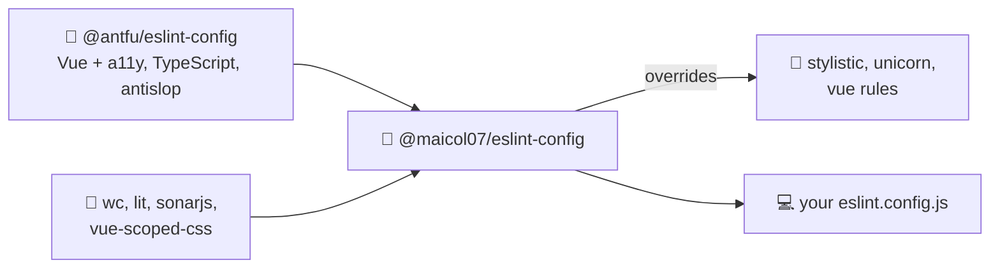

# 🧹 ESLint config

My personal ESLint flat config: [`@antfu/eslint-config`](https://github.com/antfu/eslint-config)
with my stylistic preferences and the plugins I use for Vue, Lit and web components.



---

## 📥 Installation

> [!note]
> `eslint` (v10) and `typescript` (v5 or v6) are **peer dependencies**: the config uses the ones installed
> in your project. Recent npm, pnpm and Bun install them automatically if they are missing.

> [!warning]
> **TypeScript 7 is not supported yet**: typescript-eslint and `eslint-plugin-sonarjs` still need
> the TypeScript 6 API. Status: [#4](https://github.com/maicol07/eslint-config/issues/4).
>
> To use TS 7 in your project, alias `typescript` to the TS 6 compatibility package for ESLint and
> install TS 7 under another name ([details](https://devblogs.microsoft.com/typescript/announcing-typescript-7-0/#running-side-by-side-with-typescript-6.0)):
>
> ```json
> {
>   "devDependencies": {
>     "@typescript/native": "npm:typescript@^7.0.2",
>     "typescript": "npm:@typescript/typescript6@^6.0.2"
>   }
> }
> ```
>
> `npx tsc` then runs TS 7, and ESLint keeps using TS 6.

<details open>
<summary><b>pnpm</b> (recommended)</summary>

```bash
pnpm add -D @maicol07/eslint-config eslint typescript
```

Add `*eslint*` to `public-hoist-pattern` in your `.npmrc` (if you have overridden it) to avoid
hoisting issues.
</details>

<details>
<summary><b>npm</b></summary>

```bash
npm install -D @maicol07/eslint-config eslint typescript
```
</details>

<details>
<summary><b>Bun</b></summary>

```bash
bun add -d @maicol07/eslint-config eslint typescript
```

With the isolated linker, set `publicHoistPattern = ["*eslint*"]` under `[install]` in `bunfig.toml`.
</details>

---

## 🚀 Usage

Create an `eslint.config.js` (or `.ts`) in the root of your project:

```js
export {default} from '@maicol07/eslint-config';
```

> [!important]
> Type-aware TypeScript rules read the `tsconfig.json` in the project root: make sure it exists.

The default export is a [`FlatConfigComposer`](https://github.com/antfu/eslint-flat-config-utils),
so you can extend it:

```js
import config from '@maicol07/eslint-config';

export default config
  .append({ignores: ['dist']})
  .override('antfu/stylistic/rules', {
    rules: {'style/semi': ['error', 'never']}
  });
```

Run `bun run inspector` here (or `npx @eslint/config-inspector` in your project) to browse the
resulting configs and their names.

### What it includes

| Source | |
|---|---|
| [`@antfu/eslint-config`](https://github.com/antfu/eslint-config) | base config, with Vue (+ [a11y](https://github.com/vue-a11y/eslint-plugin-vuejs-accessibility)), type-aware TypeScript and antislop enabled |
| [`eslint-plugin-wc`](https://github.com/43081j/eslint-plugin-wc) | `recommended` + `best-practice` |
| [`eslint-plugin-lit`](https://github.com/43081j/eslint-plugin-lit) | `recommended` |
| [`eslint-plugin-sonarjs`](https://github.com/SonarSource/SonarJS) | `recommended` |
| [`eslint-plugin-vue-scoped-css`](https://github.com/future-architect/eslint-plugin-vue-scoped-css) | `recommended` |
| [`globals`](https://github.com/sindresorhus/globals) | browser globals |

On top of these: semicolons, no trailing commas, no spaces inside braces, always parenthesized arrow
parameters and 1TBS braces. See [`index.ts`](index.ts) for every override.

---

## 👩‍💻 Development

```bash
git clone https://github.com/maicol07/eslint-config.git && cd eslint-config
bun install
bun run build       # compiles index.ts to index.js + index.d.ts
bun run inspector   # opens the config inspector
```

### 🔖 Releasing

```bash
npm version <patch|minor|major>
npm publish
```

`prepublishOnly` lints `index.ts` with no warnings allowed and rebuilds before publishing.

---

## 📄 License

MIT
